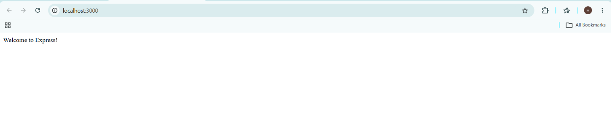
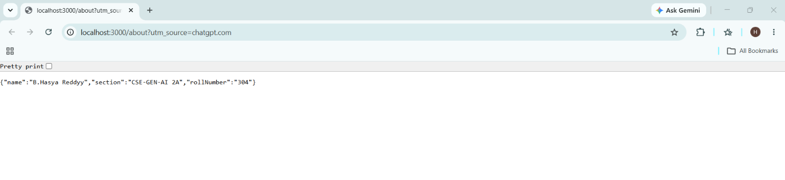
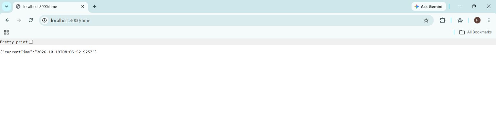
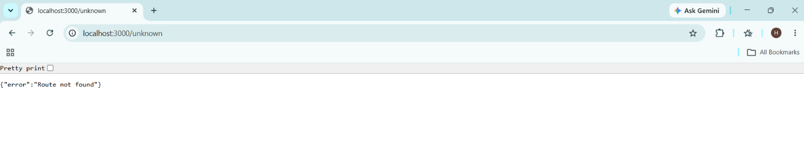

# Lab 1: Node.js and Express Server

## Student Details

- **Name:** B. Hasya Reddy
- **Registration Number:** 252U1R9019
- **Section:** CSE-GEN-AI 2A
- **Course:** Backend Development Fundamentals
- **Lab Number:** 01

## Live Deployment

**Status:** Successfully deployed on Render.

**Live URL:** https://backend-development-fundamentals-lab-01-c1tq.onrender.com/

[Open Live Server](https://backend-development-fundamentals-lab-01-c1tq.onrender.com/)

## Objective

To understand the fundamentals of Node.js and Express.js by creating a basic HTTP server using Node.js and developing an Express server with multiple routes.

## Technologies Used

- Node.js
- Express.js
- JavaScript
- npm
- Git and GitHub
- Render

## Project Structure

```text
lab-01/
├── server.js
├── app.js
├── package.json
├── package-lock.json
├── .gitignore
├── README.md
└── screenshots/
    ├── home.png
    ├── about.png
    ├── time.png
    └── 404.png
```

## Features

1. Creates a basic HTTP server using Node.js.
2. Displays a welcome message on the home route.
3. Returns student details in JSON format through the About route.
4. Returns the current date and time through the Time route.
5. Handles unknown routes with a 404 status code.
6. Deploys the Express server online using Render.

## Installation and Setup

### Prerequisites

- Node.js and npm installed
- Git installed
- A code editor such as Visual Studio Code

### 1. Clone the Repository

```bash
git clone https://github.com/hasyareddy00-cloud/backend-development-fundamentals-lab-01.git
```

### 2. Open the Project Folder

```bash
cd backend-development-fundamentals-lab-01
```

### 3. Install Dependencies

```bash
npm install
```

## How to Run

### 1. Run the Basic Node.js HTTP Server

```bash
node server.js
```

Open the following URL in your browser:

http://localhost:3000

The server responds with:

```text
Hello
```

Stop the server by pressing `Ctrl + C` before starting the Express server.

### 2. Run the Express Server

```bash
npm start
```

The Express server starts on port 3000 locally.

Open the endpoints listed below to test the server.

## API Endpoints

| HTTP Method | Endpoint | Description | Expected Status |
|---|---|---|---|
| GET | `/` | Displays a welcome message | 200 OK |
| GET | `/about` | Returns student details in JSON | 200 OK |
| GET | `/time` | Returns the current date and time | 200 OK |
| GET | `/anything` | Returns an error for an unknown route | 404 Not Found |

## Screenshots

### 1. Home Route



### 2. About Route



### 3. Time Route



### 4. 404 Error Response



## Problems Faced and Solutions

- **Port conflict:** Both the Node.js HTTP server and Express server use port 3000. The first server must be stopped before starting the second.
- **Unknown routes:** Express middleware was added to return a 404 response for unconfigured routes.
- **Deployment configuration:** The application was configured to use `process.env.PORT || 3000` so it can run locally and on Render.
- **Endpoint testing:** Each endpoint was tested in the browser.

## Learning Outcomes

- Learned how to create an HTTP server using Node.js.
- Understood the purpose of Express.js.
- Practiced creating GET routes.
- Learned to return text and JSON responses.
- Used `new Date()` to return the current date and time.
- Understood HTTP status codes 200 and 404.
- Practiced using Git and GitHub for version control.
- Learned how to deploy a Node.js application using Render.

## Viva Questions and Answers

### 1. What is the difference between `package.json` and `node_modules`?

- `package.json` contains project details, scripts, and dependency declarations.
- `node_modules` contains the installed packages used by the application.

### 2. What does `app.listen()` do?

It starts the Express server and makes it listen for incoming requests on a specified port.

### 3. What are request and response?

- **Request:** Information sent from a client to a server.
- **Response:** Data and status information sent from a server to a client.

### 4. What is Express.js?

Express.js is a web framework for Node.js that simplifies server creation and route handling.

### 5. What is HTTP status code 404?

It indicates that the requested route or resource was not found.

### 6. Why do we use `process.env.PORT || 3000`?

It uses the port provided by the hosting platform or defaults to port 3000 when running locally.

## GitHub Repository

[View Lab 1 Repository](https://github.com/hasyareddy00-cloud/backend-development-fundamentals-lab-01)

## Deployment Notes

- **Platform:** Render
- **Status:** Successfully deployed
- **Live URL:** https://backend-development-fundamentals-lab-01-c1tq.onrender.com/
- **Build Command:** `npm install`
- **Start Command:** `npm start`
- **Root Directory:** Repository root
- **Environment Variables:** No manually configured variables required

The application was tested using the deployed URL and its endpoints.

## Submission Checklist

- [x] Student details included.
- [x] Node.js HTTP server created.
- [x] Express routes implemented.
- [x] 404 error handling implemented.
- [x] Screenshots included in the README.
- [x] Live deployment URL added.
- [x] Code pushed to GitHub.
- [x] `node_modules` excluded from Git.
- [x] `.env` excluded from Git.
