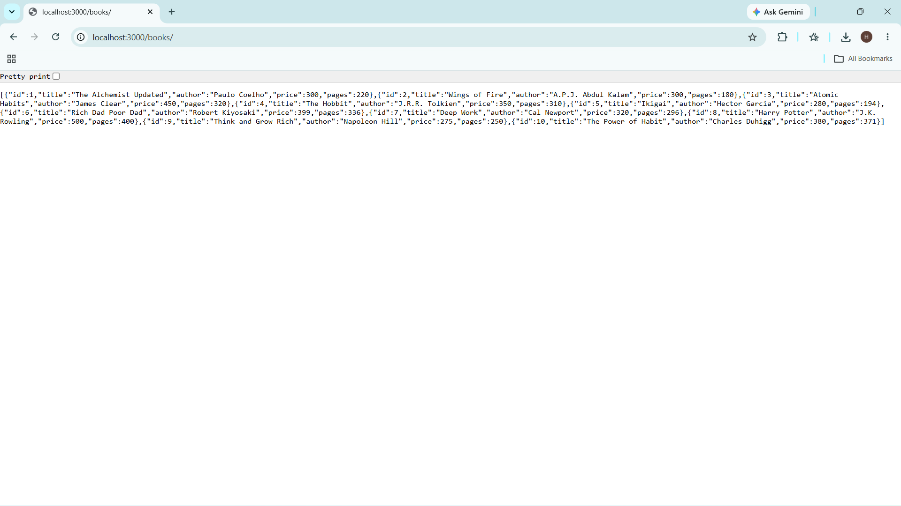
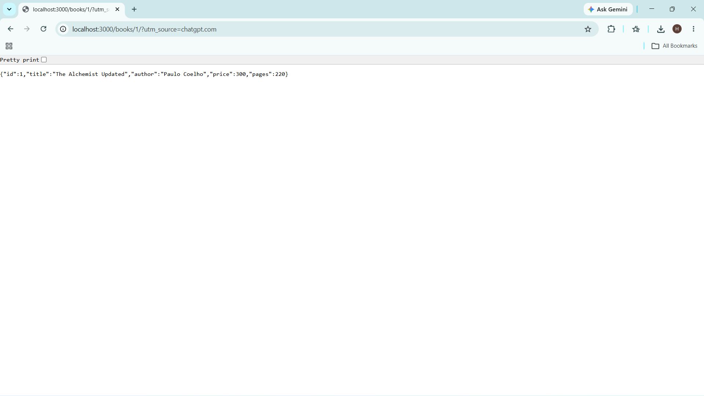
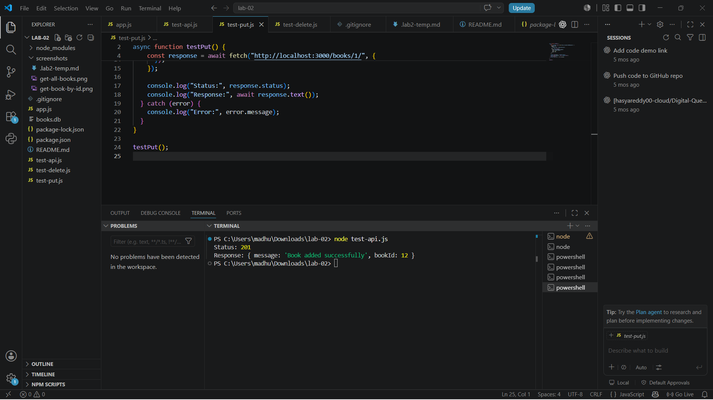
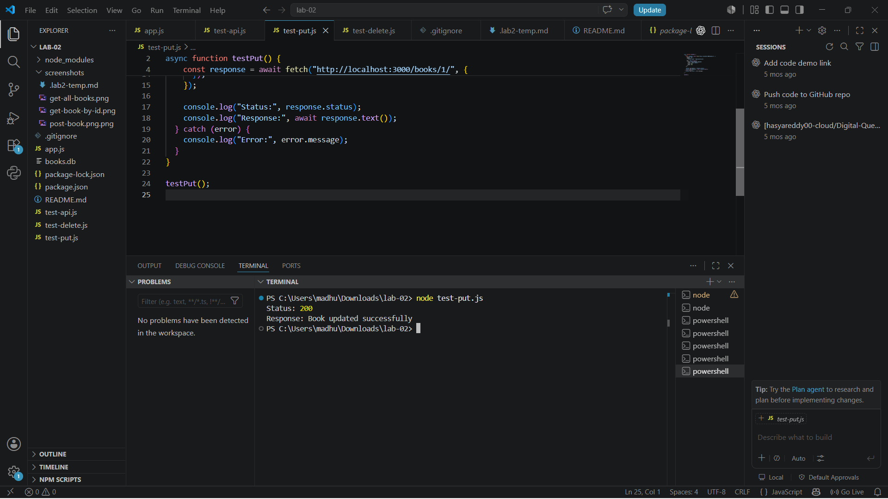
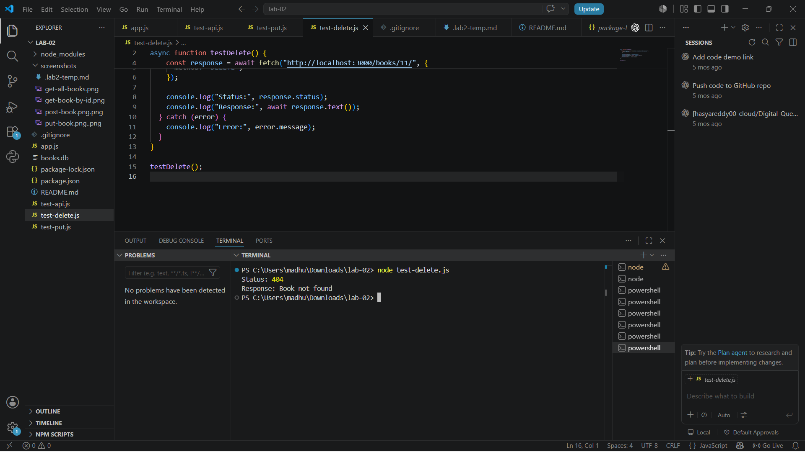
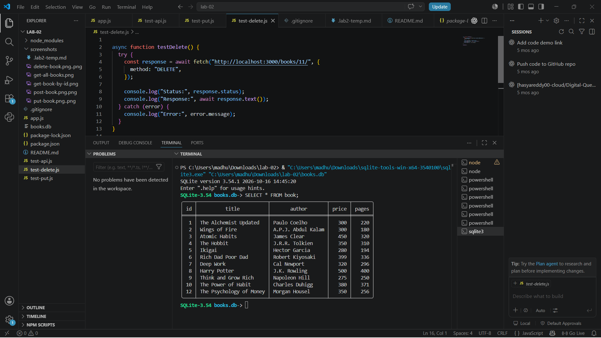

# Lab 2: SQLite Database and CRUD Operations

## Student Details

- **Name:** B. Hasya Reddy
- **Registration Number:** 252U1R9019
- **Class:** CSE-GEN-AI 2A
- **Course:** Backend Development Fundamentals

## Project Description

This project implements a REST API using Node.js, Express.js, and SQLite. It supports CRUD operations (Create, Read, Update, and Delete) for managing books.

## Technologies Used

- Node.js
- Express.js
- SQLite
- sqlite3
- sqlite
- Nodemon
- Postman

## Project Structure

```text
lab-02/
├── app.js
├── books.db
├── package.json
├── package-lock.json
├── .gitignore
├── README.md
├── screenshots/
│   ├── get-all-books.png
│   ├── get-book-by-id.png
│   ├── post-book.png
│   ├── put-book.png
│   ├── delete-book.png
│   └── sqlite-books.png
├── test-api.js
├── test-put.js
└── test-delete.js
```

## Installation and Setup

### Prerequisites

Install Node.js and npm.

### Install Dependencies

```bash
npm install
```

### Start the Server

```bash
npm start
```

The server runs at:

`http://localhost:3000`

## API Endpoints

| Method | Endpoint | Description |
|---|---|---|
| GET | `/books/` | Retrieve all books |
| GET | `/books/:bookId/` | Retrieve a book by ID |
| POST | `/books/` | Add a new book |
| PUT | `/books/:bookId/` | Update a book by ID |
| DELETE | `/books/:bookId/` | Delete a book by ID |

## Testing the API

The API endpoints were tested successfully using the Postman Desktop application. All five CRUD operations (GET all books, GET book by ID, POST, PUT, and DELETE) returned successful responses. The SQLite command-line tool was also used to verify the database records.

### 1. Get All Books



### 2. Get a Book by ID



### 3. Add a Book (POST)



### 4. Update a Book (PUT)



### 5. Delete a Book (DELETE)



### 6. SQLite Database Records



## SQL Injection Prevention

Parameterized SQL queries using `?` placeholders are used when passing user input into SQL statements. This helps prevent SQL injection.

## Problems Faced

- Installing and configuring the SQLite command-line tool.
- Setting up Postman Desktop Agent to send requests to localhost.
- Testing API endpoints and capturing screenshots of the results.

## Deployment

**Live Deployment URL:** https://backend-lab-02.onrender.com

**API Endpoint:** https://backend-lab-02.onrender.com/books/
## Environment Variables

No environment variables are required for the current local version.

## Conclusion

The project demonstrates CRUD operations using Express.js and SQLite. The API was tested for retrieving, adding, updating, and deleting book records.
