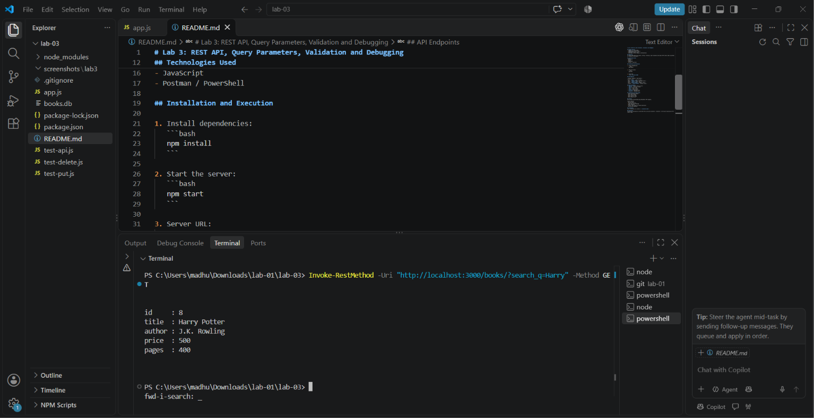
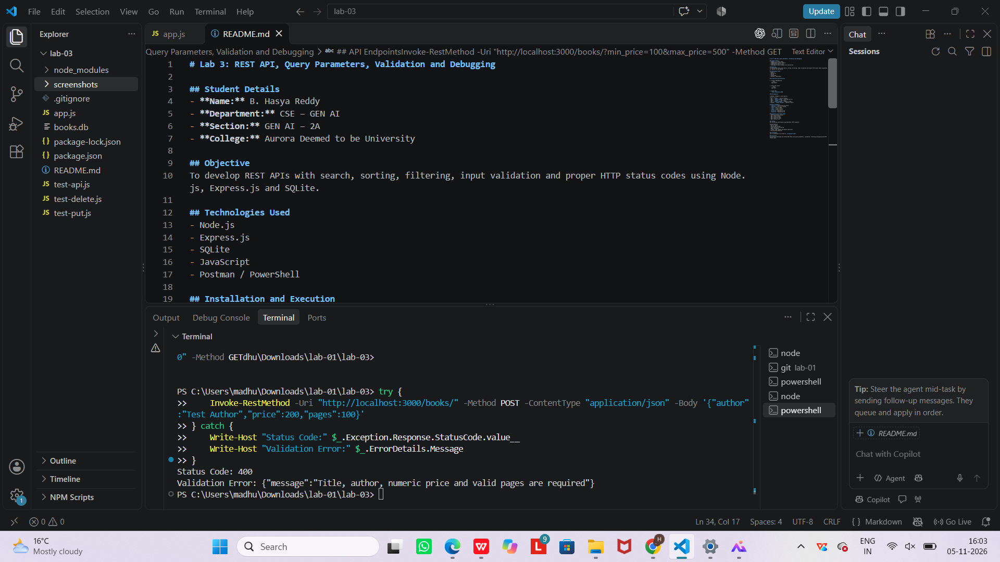
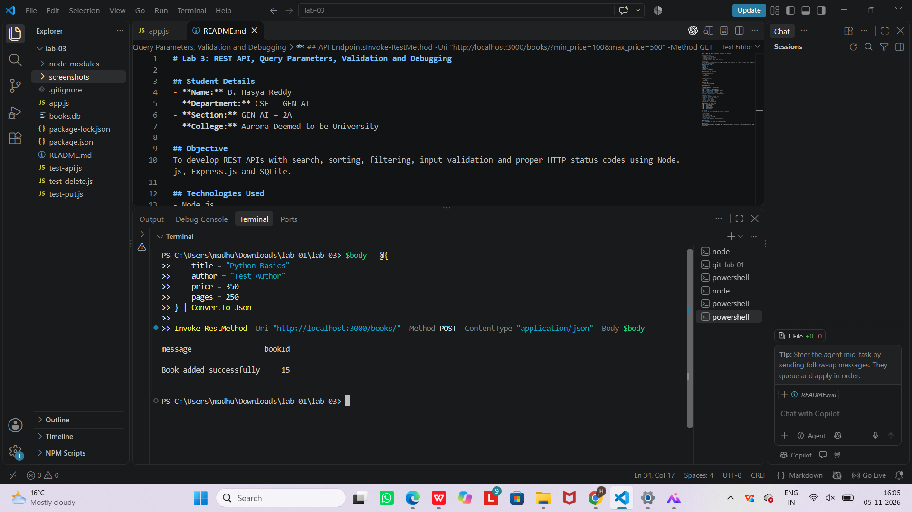
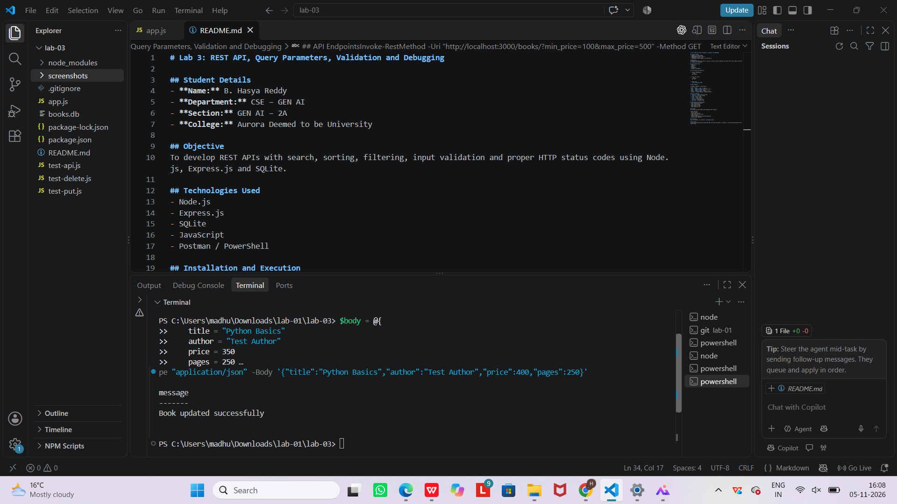
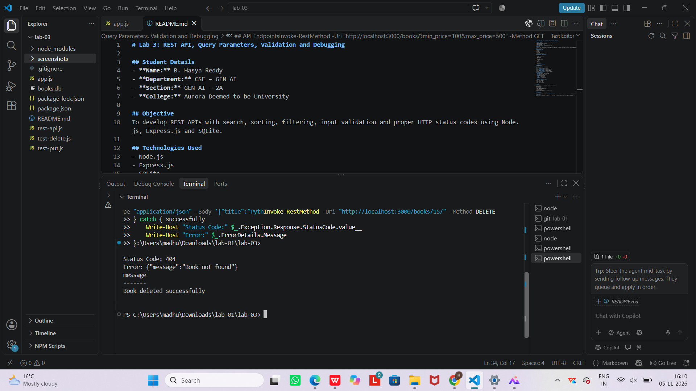

# Lab 3: REST API, Query Parameters, Validation and Debugging

## Student Details

- **Name:** B. Hasya Reddy
- **Department:** CSE – GEN AI
- **Section:** GEN AI – 2A
- **College:** Aurora Deemed to be University

## Objective

To develop REST APIs with search, sorting, filtering, input validation and proper HTTP status codes using Node.js, Express.js and SQLite.

## Technologies Used

- Node.js
- Express.js
- SQLite
- JavaScript
- PowerShell for API testing
- VS Code

## Installation and Execution

### 1. Clone the Repository

```bash
git clone https://github.com/hasyareddy00-cloud/backend-development-fundamentals-lab-01.git
```

### 2. Navigate to the Lab 3 Folder

```bash
cd backend-development-fundamentals-lab-01/lab-03
```

### 3. Install Dependencies

```bash
npm install
```

### 4. Start the Server

```bash
npm start
```

### 5. Local Server URL

```text
http://localhost:3000
```

## API Endpoints

| Method | Endpoint | Description |
|---|---|---|
| GET | `/books/` | Get all books |
| GET | `/books/:bookId/` | Get book by ID |
| POST | `/books/` | Add a book |
| PUT | `/books/:bookId/` | Update a book |
| DELETE | `/books/:bookId/` | Delete a book |

## Query Parameters

| Parameter | Description |
|---|---|
| `search_q` | Search books by title |
| `order_by` | Sort by a column |
| `order` | Sort in ASC or DESC order |
| `limit` | Limit the number of results |
| `offset` | Skip a number of results |
| `min_price` | Filter by minimum price |
| `max_price` | Filter by maximum price |

### Example Requests

- **Search:** `/books/?search_q=Harry`
- **Sort:** `/books/?order_by=price&order=ASC`
- **Limit:** `/books/?limit=5&offset=0`
- **Price Filter:** `/books/?min_price=300&max_price=400`

## Validation and Status Codes

- **200 – OK:** Successful request.
- **201 – Created:** Book created successfully.
- **400 – Bad Request:** Invalid input or missing required fields.
- **404 – Not Found:** Book not found.
- **500 – Internal Server Error:** Server-side error.

Input validation checks required fields such as title and author, and validates numeric price values.

## Testing

API testing was performed using PowerShell HTTP requests.

The following features were tested:

- Get all books.
- Search books by title.
- Sort books in ascending order.
- Limit and filter results.
- Filter books using minimum and maximum prices.
- Validate POST request data.
- Create a new book.
- Read a book by ID.
- Update a book.
- Delete a book.
- Handle requests for missing book IDs.

## Screenshots

The following screenshots demonstrate the REST API testing results.

### 1. Search Books



### 2. POST Validation Error



### 3. Successful POST Request



### 4. Successful PUT Request



### 5. DELETE and 404 Response



## Live Deployment

**Platform:** Render

**Live Server URL:**  
https://backend-lab-03-yzg3.onrender.com

**Books API Endpoint:**  
https://backend-lab-03-yzg3.onrender.com/books/

## Conclusion

Successfully developed and deployed REST APIs using Node.js, Express.js and SQLite. Implemented search, sorting, filtering, input validation and appropriate HTTP status codes. Tested the API using PowerShell and deployed the application on Render.